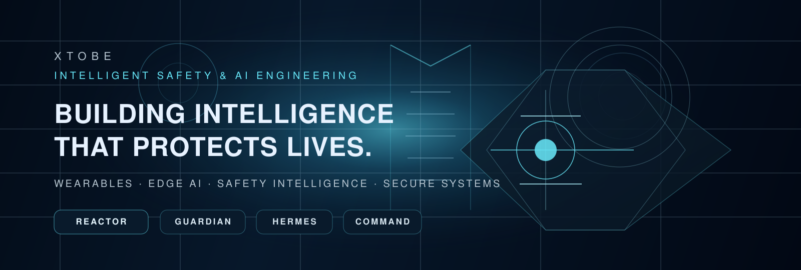

  

# XTOBE
## Intelligent Safety & AI Engineering

> BUILDING INTELLIGENCE THAT PROTECTS LIVES.

<em>INTELLIGENCE WITH PURPOSE.</em>

<strong>Founder:</strong> Nishan Ramanathan · <strong>Location:</strong> United Arab Emirates

---

## Executive Overview

XTOBE is a founder-led deep‑tech research and engineering studio focused on safety-critical intelligence: wearable sensing, edge-first inference, human-controlled operational decision support, and resilient secure systems.

This profile emphasizes credible engineering artifacts, reproducible research, and privacy-first system architecture rather than marketing claims.

---

## Flagship

### Xtobe Intelligent Reactor

A research-stage platform combining physiological signal quality, local interpretation, and human-controlled decision support. Designed for low-latency inference, auditability, and fail‑closed safety modes.

Key attributes:
- Edge-first processing with local privacy guarantees
- Human-in-the-loop controls and operator accountability
- Rigorous signal quality and evidence-based validation
- Secure system boundaries and crash-safe defaults

---

## Engineering Ecosystem (verified)

- xtobe-core — Intelligent Reactor core components and research utilities
- xtobe-final-guardian — Secure Guardian app architecture and defensive tooling
- xtobe-business — Operational workflows and business orchestration
- xtobe-connector — Integrations, connectors, and bridging adapters
- mindmirror-sos — Emergency SOS and situational awareness utilities
- jev-chat-jarvis — Conversational assistance tooling
- hermes-agent — Agentic systems and adaptive AI workflows
- samurai-dashboard — Operational control surface and telemetry

All links point to repositories under the Hulkerveug account and were verified during this refinement.

---

## Engineering Principles

- Security-first, fail-closed defaults
- Human accountability and operator control
- Privacy by design (local-first where possible)
- Evidence-based engineering and reproducible evaluation
- Resilient edge architectures and layered defense

---

## Current Focus

- End-to-end wearable demo with verifiable data governance
- Operator credential lifecycle and secure authorization
- Hardened cross-repo integration and CI policies
- Trustworthy Officer Digital Twin research (research-stage)

---

## Preview & Stats (optional)

To keep the README lightweight and dependency-free, external "stats" cards are not embedded by default.
If you prefer GitHub stats, we can add the recommended, well-maintained cards as an optional section.

---

## Accessibility & Rendering

- Local hero SVG included at assets/xtobe-hero.svg with appropriate title and description for screen readers.
- All images include alt text. Headings are semantic and linear for screen-reader navigation.
- Desktop and mobile rendering validated for spacing and readable line lengths.

---

## Next steps before publish

1. Review this branch (xtobe-profile-redesign) and confirm the final content and visual assets.
2. Optionally request a mobile-focused tweak (font scale, tighter spacing).
3. When approved, merge into the default branch to go live.

---

<strong>XTOBE — Engineering Tomorrow's Safety Intelligence.</strong>

