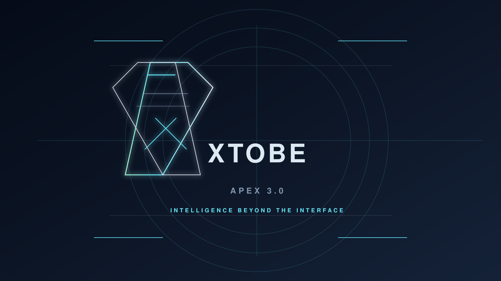
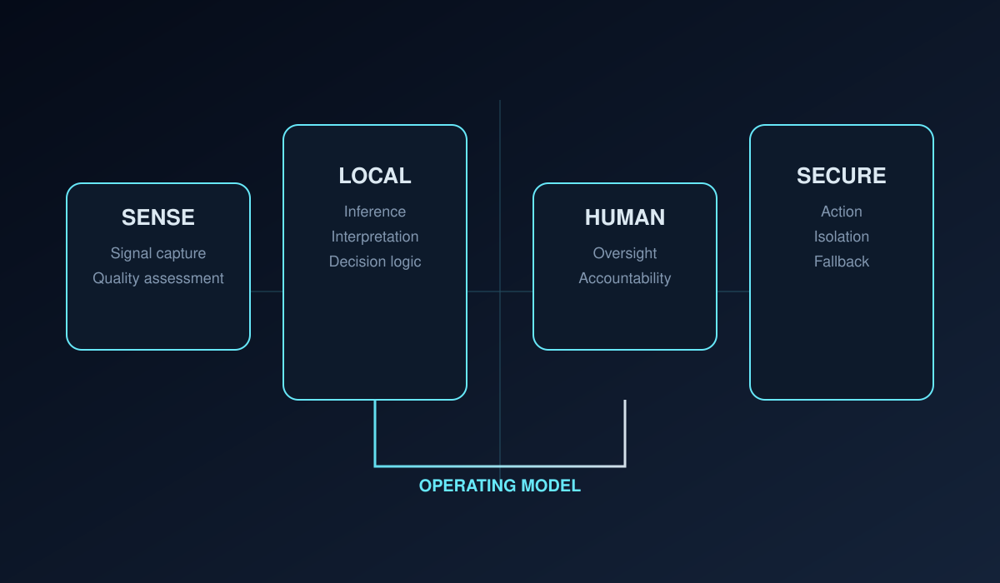

  

# XTOBE
## APEX 3.0 — INTELLIGENCE BEYOND THE INTERFACE

> ENGINEERING INTELLIGENCE THAT PROTECTS LIVES.

<strong>Founder:</strong> Nishan Ramanathan · <strong>Location:</strong> United Arab Emirates

XTOBE is a founder-led deep-tech research and engineering studio building safety-critical intelligence for human-first operations. The portfolio spans physiological sensing, edge-native inference, operator accountability, and research-grade validation for systems designed to protect life in high-consequence environments.

---

## Flagship program

### Intelligent Reactor

A research-stage safety intelligence architecture integrating signal acquisition, local inference, human control, and accountable decision support.

- Physiological sensing and signal quality assessment
- Edge-local interpretation with privacy boundaries
- Human-in-the-loop oversight and operator accountability
- Audit-friendly system boundaries and fail-closed defaults

---

## Research and operational priorities

### 01 / REACTOR
Human sensing and intelligence

### 02 / GUARDIAN
Digital protection systems

### 03 / AGENTS
Secure AI orchestration

### 04 / COMMAND
Operational intelligence

These focus areas are intentionally framed as engineering programs rather than polished product claims. Status and validation remain evidence-based and conservative.

---

## Portfolio philosophy

XTOBE balances scientific ambition with disciplined engineering credibility:

- Secure-by-default architecture and privacy-aware systems
- Human accountability in operational decision cycles
- Evidence-based engineering with traceable verification
- Clear distinction between research-stage and validated systems

---

## Selected engineering themes

- Physiological computing and wearable intelligence
- Edge-first automation with low-latency local decision support
- Safety-critical operational workflows and human oversight
- Research infrastructure that respects confidentiality and data governance

---

## Evidence and verification

Public claims are intentionally restrained. Verification is tracked in the project evidence registry and only elevated when concrete source links, commands, and outputs are available.

- `XTOBE_PUBLIC_EVIDENCE.md` — evidence policy and public registry framework
- `XTOBE_DESIGN_VALIDATION.md` — accessibility, rendering, and QA review
- `XTOBE_APEX_BRAND_SYSTEM.md` — design system and creative direction

---

## Connect

For research collaboration, strategic inquiry, or technical discussion, start with the public profile and project repositories under the XTOBE ecosystem.

- GitHub: [Hulkerveug](https://github.com/Hulkerveug)
- Profile branch: `xtobe-profile-redesign`

---

<strong>XTOBE — Engineering intelligence that protects lives.</strong>

